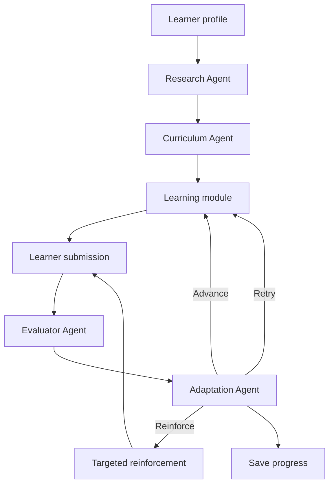

# Averroes

**Less memorizing. More making.**

Averroes is an independent AI-powered learning project inspired by the project-based learning methodology of the 42 school network. It transforms a learner's interests, goals and current knowledge into a personalized curriculum built around practical exercises and demonstrated mastery.

Rather than simply providing answers, Averroes aims to help learners develop knowledge through research, practice, evaluation and continuous improvement.

## How it works

1. Define a topic, learning goal and current skill level.
2. Research the domain, its prerequisites and appropriate learning methods.
3. Generate a progressive curriculum with exercises, objectives and mastery criteria.
4. Complete the current module and submit work through the terminal.
5. Receive an evaluation identifying strengths, weaknesses and concept-level mastery.
6. Advance, retry or receive targeted reinforcement based on the evaluation.

Learning progress and submission history are saved locally. Individual modules can also be exported as PDF documents.

## Multi-agent architecture

Averroes uses four specialized agents built with Strands Agents:

| Agent | Responsibility |
| --- | --- |
| Research Agent | Researches the subject using the Wikipedia API and identifies prerequisites, learning methods and assessment approaches. |
| Curriculum Agent | Builds structured learning paths and targeted reinforcement modules. |
| Evaluator Agent | Assesses submitted work against module objectives and mastery criteria. |
| Adaptation Agent | Recommends the next learning step based on demonstrated performance. |

The orchestrator coordinates these agents, passes structured data between them and updates the learner's state.



## Technology stack

- **Python 3.14+** — application logic
- **Strands Agents** — AI agent framework and tool integration
- **Ollama / Qwen3 8B** — local language model inference
- **Pydantic** — structured outputs and data validation
- **Requests / Wikipedia API** — domain research
- **ReportLab** — PDF generation
- **JSON** — local learner state and history
- **uv** — dependency and environment management

## Getting started

### Prerequisites

Install [uv](https://docs.astral.sh/uv/getting-started/installation/) and [Ollama](https://ollama.com/download). An internet connection is required for Wikipedia research and the initial model and dependency downloads.

### Installation

Clone the repository:

```bash
git clone https://github.com/roarztco/Averroes.git
cd Averroes
uv sync
```

Start Ollama if it is not already running:

```bash
ollama serve
```

In another terminal, download the model and start Averroes from the repository root:

```bash
ollama pull qwen3:8b
uv run python main.py
```

The default model and Ollama endpoint (`http://localhost:11434`) are configured in `model.py`.

## Usage

The command-line interface provides the following options:

```text
1. Create learning path
2. Submit work
3. View progress
4. View current module
5. Generate current module PDF
6. View learning history
7. Exit
```

When submitting work, paste your answer or implementation and type `END` on a separate line to submit it for evaluation.

Progress is stored in `data/learner_state.json`, and generated module PDFs are saved in `generated_modules/`. Creating a new learning path replaces the existing saved learner state.

## Project structure

```text
Averroes/
├── agents/
│   ├── research_agent.py
│   ├── curriculum_agent.py
│   ├── evaluator_agent.py
│   └── adaptation_agent.py
├── tools/
│   └── research_tools.py
├── data/
├── generated_modules/
├── src/skillfoundry/
├── main.py
├── model.py
├── orchestrator.py
├── schemas.py
├── state.py
├── progress.py
├── pdf_generator.py
├── pyproject.toml
└── uv.lock
```

## Project status

Averroes is an experimental command-line prototype under active development. Some internal names still use the earlier name SkillFoundry.

Evaluation is based on AI analysis of text submissions, not automated execution or formal verification of the learner's work. The current progression logic supports advancement, retrying and targeted reinforcement; skipping modules and changing the curriculum path are recognized recommendations but are not yet implemented as state transitions.

## Philosophy

Knowledge is not measured by how much information someone consumes, but by what they can understand, apply and create.

Averroes explores how artificial intelligence can support independent learning without replacing the effort that makes learning meaningful.
